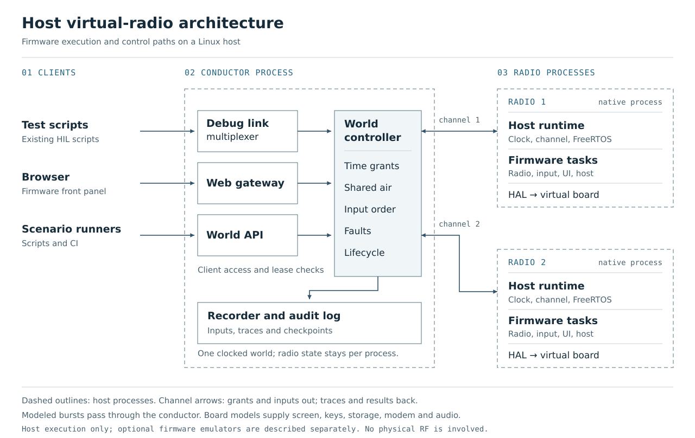
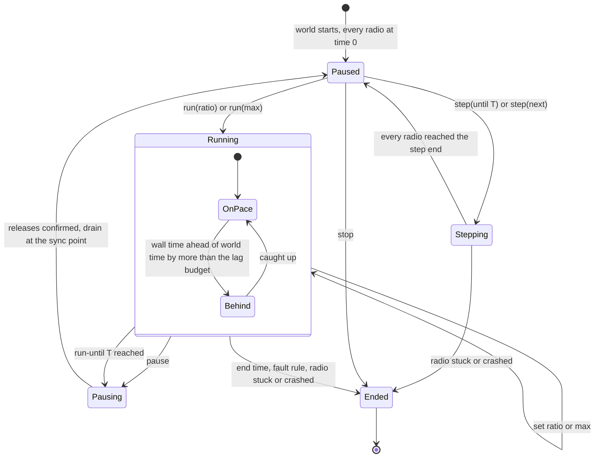

<!-- SPDX-License-Identifier: MIT -->
<!-- Copyright (c) 2026 The RadioFoundry Authors -->

# The Virtual Radio: Architecture

How the virtual radio is built: its layers, its seams, how time works, how clients drive and watch it, what a
recording holds. Start with [virtual-radio.md](virtual-radio.md).
Each decision has an ADR in [adr/](adr/README.md).

This page describes the host virtual radio in this unmerged fork. The optional Renode and QEMU adapters have a
smaller supported interface; see [engine capabilities](virtual-radio.md#engine-capabilities). Accepted decisions
below are decisions within this preview, not upstream approvals. Alternatives and future extensions are not shipped
features.

## What the virtual radio is

A **virtual radio** is one radio's firmware core built for a PC and run on a **virtual board**. It runs the
firmware's own startup and its own FreeRTOS tasks on a deterministic host port. It does not run the flashed program
and it does not emulate the chip. Many virtual radios form a **world**: the radios, the **air** between them and one
**virtual time**.

One example shows the idea. The UI task waits 1000 ms for its splash (`vTaskDelay`). On a virtual radio that wait is
1000 ms of virtual time. In max-speed mode, elapsed wall time depends on the host because virtual time advances
when every task waits. The same boot can then be checked for a byte-identical trace across runs.

## Terms

These terms distinguish the firmware, its environment and its clients:

| Term | Meaning here | Do not confuse with |
|---|---|---|
| Virtual radio, virtual board, host platform | The firmware core on a PC; the board of software models; `platform/host/` | "emulator", "simulator", "host" alone |
| World, session | Everything in one run; one run of a world | a DMR network; a CPS session |
| World controller | The part that moves virtual time and passes bursts over the air | a client role (below) |
| Controller | The one client that holds the lease on a radio and may send it input | the world controller |
| Observer | A client that reads only host-side copies and cannot change the run | a client that polls the firmware |
| Air, air model | The shared simulated channel; its rules | "RF", "channel" |
| Scenario, recording, replay, checkpoint | What to run; what happened; running it again; a point where results are compared | a saved state to resume from |
| Screen frame | One complete picture of the screen | a burst, a link frame, an Ethernet frame |
| Virtual time, wall time | The world's clock; the PC's clock | "real time" for wall time |
| Radio view | `radio_view_t`, the core's published state | a browser page |

This spec adds five working terms. They are not in the glossary yet; they can be added in a later glossary change.

| Term | Meaning | Status |
|---|---|---|
| Conductor | The one host process per world. It holds the world controller, the debug link multiplexer, the web gateway, the recorder and the audit log. It is the only way in to a radio. | Accepted (0003, 0004) |
| Lease | The permission to control one radio. One holder at a time; a generation number makes old leases fail | Accepted (0004) |
| World client | A client that holds the world capability: time, lifecycle, faults, air, recordings. The security review calls this role "world controller"; this spec does not, to keep that name for the part that moves time | Accepted (0004) |
| Grant | The world controller's message "run until virtual time T" | Accepted (0005) |
| Sync point, lookahead | A virtual time where every radio stops so they can swap air; the shortest time in which one radio can notice what another did | Accepted (0005) |

## Layers

The firmware tasks and protocol engines are unchanged. The lowest layer supplies the virtual board, and the host
side grows around it. The shared browser page has an optional hook for the gateway's session proof.

[Open the architecture diagram at full size](images/virtual-radio-architecture.svg). Each downward stack shows
execution and interface layers; bidirectional channels carry inputs and results between the conductor and each
radio. The diagram covers the host virtual radio. The emulator adapters have the more limited capabilities listed
in the [preview overview](virtual-radio.md#engine-capabilities).

| Layer | Owns | New or kept |
|---|---|---|
| `core/` | All radio behavior | Tasks and protocol engines kept; browser page carries the optional gateway proof |
| `hal/` | The interfaces between core and board | Kept |
| `boards/vhost/` (virtual board) | Software models of the screen, keys, flash, host port, power, DMR modem and audio. An operation that needs hardware it does not model returns an explicit error, never a fake success | New |
| `platform/host/` (host platform) | `main` as the radio's `main` runs it, the virtual clock and event queue, the grant gate, the trace, crash and watchdog hooks | New |
| `platform/host/freertos/` | The host port: a fork of the MIT FreeRTOS POSIX port. Each task is a host thread; only one runs at a time | New |
| Conductor | Time, air, faults, client multiplexing, control ownership, recordings, audit | New, host only (0003, 0004, 0005) |
| Scenario tools | Versioned schemas, conversion and recording lint | Shared with the conductor |

**Process model.** One process per radio, built by the repository's own `Makefile` with `BOARD=vhost`. The
conductor is a separate host process. No radio talks to another radio; only the conductor moves bytes between them.

**What the host port guarantees**. For the same build, start state and timed inputs, a virtual radio
runs the firmware's tasks in the order the radio's own FreeRTOS kernel picks for those events at those virtual
times, with code taking no virtual time, and repeats that order byte for byte. It cannot show:

- an interrupt that lands inside plain C code or inside a critical section;
- time slicing between two tasks of the same priority;
- a task that runs late because code took too long (the radio task's "fell behind" branch never runs);
- what a loop does that spins without sleeping (the clock stops; the run ends as stuck and names the task).

These require appropriate bench or HIL tests; a passing virtual run does not cover them.

## Seams

A seam is a place where the code behind an interface can be swapped without editing the code that uses it. The
virtual radio uses the firmware's existing seams and adds none to `core/`.

| Seam | Firmware side | Virtual radio side | Source |
|---|---|---|---|
| `board_t` | `hal/board.h` | `boards/vhost` fills it like any board | [Host execution](virtual-radio-host.md), [ADR 0002](adr/0002-execution-model.md) |
| `hal_input_t` `scan()`, `encoder()` | The input task scans every 10 ms | A virtual keypad: key bits held now, encoder detents since the last scan, set by world events at virtual times. `encoder()` returns at most +/-127 and keeps the rest for the next scan | 0006 |
| `hal_display_t` `flush`, `flush_indexed` | `gfx_flush` sends changed row bands | A panel copy at native depth, plus palette and backlight | 0007 |
| `board.host_port` (`hal_stream_t`) | The host link and debug link read it | A stream fed by the conductor's per-radio channel; accepts reconnects | 0003 |
| `hal_netif_t` | HTTP, `/ws`, rigctld, mDNS | A host network interface fed by the conductor's web gateway | 0003 |
| `hal_system_t` | INFO_CHIP, READ_MEM, REBOOT | A fixed chip id, a bounded fake memory array, reboot as a process restart that keeps flash | 0003, 0004 |
| Flash | Settings, codeplug, storage | A sparse NOR model; contents come only from generator steps | 0008 |
| `hal_dmr_modem` | Slot interrupts, PCM blocks, `now_us`, `slot_clock` | A virtual modem that puts its events on the radio's own clock and states its lookahead | [Time model](adr/0005-time-model.md), `boards/vhost/dmr_vhost.c` |
| Time (`hal_millis`, `hal_micros`, tick) | Read a cycle counter and a timer interrupt | One virtual clock per radio | 0005 |
| Link wraps | `gfx_flush`, `ui_app_status`, the idle hook | `-Wl,--wrap` calls the real function, then records. No new call into the firmware | 0007, 0008 |
| Context switch | The port | Behind one function, so a later WebAssembly build can swap threads for fibers | [Host execution](virtual-radio-host.md), [ADR 0002](adr/0002-execution-model.md) |
| Per-radio control channel | none (host only) | Grant in; next due time, outbox and trace out. Must carry a full debug link reply (6 + 1024 + 2 bytes); the research channel's 600 byte cap is not enough | 0003, 0005 |

**Fallbacks.** If a link wrap fails under production build flags, the fallback is a small optional hook: a
`hal_display_t.frame_done` member for screen frames, and a similar hook for the UI status. Real boards leave them
NULL (0007, 0008).

## Time model

### One clock per radio

| Time source | Driver |
|---|---|
| `hal_millis`, `hal_micros` | The radio's virtual clock in µs. `hal_millis` is µs / 1000; `hal_micros` is µs cut to 32 bits and wraps as on the radio |
| RTOS tick and every RTOS timeout | A tick event every 1000 µs of the same clock. Every tick is delivered; no tickless jumps |
| Modem `now_us` | The same clock as `hal_micros`. Both radio platforms read one counter for both |
| Modem slot edges, `slot_clock`, PCM blocks | Events the virtual modem and audio part put on the same clock (30 ms and 20 ms). Each radio has its own slot phase; a slot clock restart moves it. No shared grid is assumed |
| GPS UTC and date | A world epoch from the scenario plus world time. Never the PC's date |
| Per-radio offset and drift | Later, in the world controller, as integers. First slice: zero |

The clock stands still while firmware code runs. **Reading the clock never moves it.** When every task waits, the
clock jumps to the next due event. A loop that polls the clock without sleeping never ends and the run is ended as
stuck. An opt-in "assist after many still reads" was considered as a future alternative; it is not implemented.

### What a wait means

| Wait | Meaning in virtual time |
|---|---|
| `vTaskDelay`, `vTaskDelayUntil`, queue, semaphore and notify timeouts | The task sleeps; time moves only when every task waits |
| `hal_delay_ms` once the scheduler runs | `vTaskDelay`, as on the radio |
| `hal_delay_ms` before the scheduler or while it is suspended, `hal_delay_us` | A busy wait: the clock moves by the wait's length, events due in that span run with their interrupts. It stops at the grant end. Before the scheduler it also feeds the watchdog, as the radio does |
| Take with `portMAX_DELAY` | Sleeps until given |
| A bare spin, or a loop that polls the clock | Never ends; the stall watch ends the run and names the task |

### The world controller and grants

The world controller owns world time. It sends every radio a **grant**: "run until T". T is the earliest of:

1. the next world event (a scripted input, a fault);
2. now plus the **air lookahead**: 1 ms by default while radios share an air, or the modem's stated 30 ms with
   `lookahead_proven` enabled after checking the scenario; no air cap when radios share no air;
3. now plus the **pacing cap**: 1 ms by default at a speed ratio or with a live client; none in max mode with no
   live client.

Each radio runs alone to T. It handles every event due before T; its idle jump and its busy waits stop with the clock
at T, before any event due at T runs. Events due at exactly T, the tick included, run in the next grant, together
with the inputs the conductor stamps T. So an input on a grant boundary lands before that time's tick, whatever the
grant size. Each radio answers with its next due time and its
outbox (air bursts with their virtual times, client bytes). The world controller waits for every radio, reads the
outboxes in radio-number order (never arrival order), decides collisions only after it holds every outbox, and turns
bursts into receive events for the next grant. The grant end is not an event the firmware sees, so the trace does
not depend on the grant size.

**Stopping at T.** Where the world stops (pause, step, run-until), the world controller sends one more message,
**drain T**: every radio handles every event due at exactly T, in all its rounds, and nothing later. So every stop
point has T fully handled, and `step(next)` includes everything due at that time. After a drain, the next grant and
any input stamped for it start at T + 1 µs.

**The lookahead check.** The same scenario with 1 ms grants and with the stated lookahead, at real time and at max,
gives the same trace byte for byte. The scenario includes an input due exactly on a grant boundary. A lookahead is
used only after it passes.

### Shared air policy

The simulator's policy is defined in `tools/conductor/airmodel.py`; `tools/conductor/tests/test_airmodel.py`
checks each rule and input-order independence. This is a repeatable burst model, not a propagation or RF model.

A burst is rejected first by global link state or a sender's dropped-burst list. Receivers then apply channel,
timeslot, directed-link state, half duplex, collision, color code and seeded loss, in that order. Rejections name
the first matching rule. Accepted bursts may be delayed, XOR-corrupted (data only), or duplicated. A corruption
preserves payload length; both duplicates contain the resulting payload.

Half duplex and collisions use overlapping on-air starts, including bursts from adjacent grants. Starts less
than 29,999 microseconds apart overlap for this policy. The last microsecond is excluded because delivery occurs
at start + 29,999, before a burst starting at that instant is known. This causal boundary keeps decisions
independent of grant size; it is not a measured RF capture threshold.

Loss is deterministic: SHA-256 hashes `pack("!QIIQ", seed, sender_id, receiver_id, burst_ordinal)`. Interpret its
first eight bytes as a big-endian integer. Drop when `sample * 1000000 < loss_ppm * 2**64`. Use the configured DMR
identity for each radio, or its radio number when no identity is supplied. No wall clock or random generator is used.

### Pacing

Pacing decides only when, in wall time, the next grant goes out. It never changes what the firmware sees.

| State | Rule |
|---|---|
| Pausing | Client commands are refused. The conductor sends releases for tracked holds and keeps granting, at the pacing cap, until each release is confirmed. Then it drains at the next sync point. With no open hold, a pause or `run-until T` stops exactly at the requested point (T for run-until); with open holds, it stops at the first sync point after every release is confirmed, and the conductor reports that stop time |
| Paused | No grant is out. Every radio waits at the same sync point with it drained. Wall time passes; virtual time does not |
| Running, ratio r | A grant ending at T goes out no earlier than its wall time and never lets T pass its wall deadline. r = 1 is real time; HIL runs use it |
| Running, max | Grants go out as fast as radios answer. For CI and scripts. Clients that wait with wall sleeps break here |
| Stepping | Only from Paused, where no lease is held, so no client hold is open. `step(until T)` runs every radio to T. `step(next)` runs to the earliest due time across all radios, with everything due then. Then Paused |
| Behind | At a ratio the world cannot keep up. Virtual time is never skipped and no event is dropped; the world runs unpaced until it catches up. Each Behind span is written to the run notes. A strict mode ends the run past a lag budget |
| Ended | End time, a stuck radio, an assert or a crash |

A resume or speed change restarts the pacing clock, so paused time is never "caught up". A slow radio slows the whole
world; no radio falls behind in virtual time. Only the whole world pauses. One radio in a debugger is allowed and
changes nothing. The stall watch counts only while a radio holds a grant or a drain (it is running firmware), and it is off for a radio started with the
debugger option, because a radio stopped at a breakpoint mid-grant looks stuck.

### Pause and live clients

Pausing releases held inputs, revokes leases and rejects mutations:

1. In Pausing, before the world stops, the conductor sends a release for every tracked key and PTT hold. These releases are
   inputs from the conductor, stamped and recorded like any other. A release counts only when confirmed: the trace
   shows the input task saw the key up (or the PTT off), or the radio is restarted with input cleared.
2. It revokes every lease. A raw debug link controller is disconnected; a browser controller reconnects as an
   observer.
3. While Paused or Stepping, client commands that would change a radio are rejected, never queued. Only world API
   commands and scenario events move the world. Observers still read the host copies.
4. On Running, control comes back only by a new, explicit lease grant.

### Order of events

Every event has an ordering key. Events at the same time never run before their cause.

| Part | Rule |
|---|---|
| 1. Virtual time, µs | Not rounded to a tick. Host bytes at 2000.400 ms run their interrupt then |
| 2. Round | Events queued before the clock reached T are round 0. An event created while T is being handled and due at T joins the next round. So no event runs before its cause, whatever its class |
| 3. Class | 10 world faults, power, start and stop; 20 air from other radios; 30 client and scenario inputs; 40 the radio's own hardware (slot edge, PCM block, supply hold); 50 RTOS tick; 99 end of run |
| 4. Sequence | The order the event was queued. The conductor numbers its events: air in radio-number order, clients in its receive order. Sources have fixed ids, never process ids |

The class rule, in one line: anything that is true "at T" is in place before code runs at T, so the tick comes last
among the events queued before T. An input created by handling T (round 1 or later) runs after that tick, because it
could not exist before its cause. The end of run (class 99) runs only after every round at its time is done.
For example: a key due at 2000 ms is now seen by the 2000 ms
scan, not the 2010 ms one.

An event due at a time already past is a bug inside the virtual radio and ends the run.

**Live inputs.** At a ratio, the conductor turns an input's wall arrival into world time through the pacing clock,
then stamps it with that time or the start of the next grant, whichever is later. In max mode it is the start of the
next grant. Lateness is written to the run notes. Two clients that send at nearly the same wall instant are ordered
by the conductor's receive order; that order repeats only because it is recorded. Scenario inputs carry their own µs
times.

**Peripherals keep state.** An interrupt is only a bell. The virtual UART needs a receive FIFO and the keypad real
pin state, so two arrivals while interrupts are off do not lose one.

## Control APIs

Three layers (0003, accepted). The firmware's two protocols stay exactly as on real radios. Everything new is host
side.

Clients share firmware behavior through the control layers in ADR 0003, rather than one
wire protocol: both protocols end in the same firmware code (input injection, the radio view), and the world API is
the same for every world client. Neither the browser nor a script has a private path to radio behavior.

| Layer | Clients | Owns | Firmware change |
|---|---|---|---|
| Debug link, through the conductor's multiplexer | Test scripts, HIL tests | Everything a program does to one radio: keys, PTT, radio ops, views, screen, log, storage, reboot | None |
| Web control (HTTP and `/ws`), through the conductor's web gateway | The browser | The shipped front panel: screen rows, audio, keys, knob, PTT, status push | Optional browser proof hook; direct-radio behavior stays |
| World API (new, host only) | World clients: CI, scenario runners | Time, radio lifecycle, faults, the air, leases, recordings | Never enters firmware |

### Who may control (0004, accepted)

| Principal | May | Enforced by |
|---|---|---|
| Unauthenticated client, other OS user, any web page | Static browser shell only; no live data | Per-user runtime folder 0700, Unix sockets 0600, peer-UID check; browser cookie plus exact-origin proof, numeric `Host` and exact `Origin` |
| Observer | Read host copies of one or more radios | Allowlist; host caches; browser control frames dropped |
| Controller | Control one radio | One lease per radio across debug link, browser and World API keypad |
| Controller with maintenance | Also REBOOT, READ_MEM, STORAGE, CRASH, WATCHDOG, CODEPLUG, STUB, RX2 | Lease plus a separate maintenance capability; never a browser |
| World client | Time, lifecycle, faults, air, recordings, granting leases | Separate socket and decoder; does not imply radio control |

The rules that shape the code:

- The conductor is the only path to a virtual radio. Unknown or unauthorized commands fail closed before the
  firmware.
- One lease per radio, granted on purpose. Never by connection order or client rank. Revocation releases tracked
  holds first, and no successor is admitted until each release is confirmed or the radio is restarted with input
  cleared.
- The multiplexer parses link frames per client, sends one request upstream at a time, and returns each reply to the
  client that asked. Never "last sender wins".
- The web gateway ends browser HTTP and WebSocket connections. It keeps one internal `/ws` to the radio (the firmware
  admits one), presents the link-host address the firmware expects, filters browser control frames by lease, and
  fans status and screen rows out to many browser sessions. An unauthenticated request loads only the static shell.
  A one-time token in the URL fragment is exchanged at `POST /session` for a host-only `HttpOnly`, `SameSite=Strict`
  cookie and a separate proof kept in exact-origin `sessionStorage`. The proof is required with the cookie for every
  live-data API, radio asset, WebSocket, unlock and control request. Numeric-loopback `Host` and exact `Origin`
  checks remain. HTTP requests use `X-RadioFoundry-Session`; WebSockets offer `rf-vr-v1` and `rf-vr-proof.<proof>`.
  Only the fixed protocol is echoed. Cookies are host-scoped, not port-scoped: another loopback service may receive
  the cookie, which alone carries no observer or controller authority. Proofs bind the session, origin, radio and
  per-launch key; no endpoint recovers a proof from a cookie. Wildcard CORS from the firmware is stripped.
- Live World API `key` and `enc` require a principal, generation and grant secret. Delivered keys use the shared
  hold tracker. Revocation cancels queued inputs and releases delivered holds before admitting a successor.
  Offline `Config.inputs` are physical inputs for a new isolated scenario, not a live control session.
- `READ_MEM` sees only a bounded fake memory array, never host memory.
- Emulator command channels use inherited pipes or owner-only Unix sockets. A conductor-managed emulator owns no
  TCP listener, and startup fails closed if that invariant cannot be verified.
- Every control attempt and lease change writes an audit event. Tokens are never logged or recorded.

### What an observer is

Requests through the firmware change task timing. Observation must not change the run.

- An **observer reads only host-side copies**: the screen frame stream, checkpoints, the trace, the log cache and
  the view cache. Its allowlisted debug link reads are answered from those caches by the conductor. It never reaches
  the firmware.
- The caches are filled by the conductor at a fixed virtual-time cadence set in the world's configuration, whether
  or not anyone watches. Those reads are conductor inputs and are recorded.
- A **controller's** requests (a HIL test's GET_VIEW or SCREENSHOT) reach the firmware, as on a real radio, and are
  recorded inputs. A SCREENSHOT reply holds redraws for 1000 virtual ms, or 250 ms for the reply that ends the
  stream, as on a real radio (0007).

- **Browsers.** When a world has the web gateway on (a world setting, fixed at creation and recorded), the gateway
  opens its one internal `/ws` and turns screen rows on at world start, whether or not a browser is attached. Browser
  sessions that attach, subscribe or leave never reach the firmware; only a controller's key, knob and PTT frames do.

So 0, 1 or many observers give the same run (the world control check), and the security rules still hold.

### World API message set

Versioned and owned by the conductor (0003). The table groups operations conceptually; it is not a copy-and-paste
wire schema. Exact command names and fields are registered in [worldapi.py](../../tools/conductor/worldapi.py) and
the modules in [parts](../../tools/conductor/parts/).

| Group | Messages |
|---|---|
| Time (0005) | `run(ratio)`, `run(max)`, `pause`, `step(until T)`, `step(next)`, `set ratio`; state events |
| Lifecycle | start a radio, power off, reboot keeping flash, end the world |
| Input (0006) | `key <bit or name> down/up at t`, `enc <n> at t`, resolved to bits from the virtual board's key map |
| Faults | power cut, frozen radio, flash faults |
| Air | loss, delay, corrupt, duplicate, link up and down |
| Control | grant and revoke a lease; grant maintenance |
| Record (0008) | create a world with recording on (a recording always starts at world creation), stop, save; replay into a new world only |
| Observe | `observe.status` (state, virtual time, ratio, air setup and policy, radios, scheduled faults, assertions), `observe.events after N` (numbered history: inputs as summaries, air decisions and deliveries, policy changes, faults, audit lines). Read only: they answer while Pausing or Stepping and add nothing to the run |

The observe messages exist so an observer such as the multi-radio console (`tools/console.py`) never needs a private
path. A world client sees pushed world events only from the moment it connects, and some facts are never pushed
(accepted inputs, the ratio, the air seed). `tools/conductor/parts/observe_api.py` keeps a bounded copy (4096 events)
and answers in pages of at most 32 KiB. Example: the console pulls `observe.events` with the last number it saw, every
100 ms, and reads screens from the frame stream. It sends no other world command; its allowlist is `status`,
`observe.status` and `observe.events`. A harness that owns the world may register assertions in Python
(`observe_api.get(world).add_assertion(name)`); scenario files cannot declare them yet.

World control from the browser goes through the console only when its owner asks for it. Watching,
radio control and world control stay three separate permissions (0004 rule 7):

1. `tools/console.py --control`, run by the user who owns the world socket, adds `pause`, `run`, `step`,
   `set_ratio`, `fault` and `world_control.audit` to the console's allowlist. No key, PTT, lease or debug link
   command is ever on it; radio control stays with leases and the radio pages.
2. The terminal prints a second one-time code. A logged-in page gets the control capability only by pasting it
   (`POST /api/unlock`); it works once.
3. Both `POST /api/unlock` and `POST /api/control` need the exact `Host`, the session cookie, an `Origin` that is
   present and exact, the `X-RadioFoundry-Session` proof as the CSRF check, `Content-Type: application/json`, a strict body of at most 1 KiB, and a free slot
   in the session's rate limit. `/api/control` additionally requires that session's unlocked capability. The console then sends an ordinary world API command with `"actor": "console:s1"`.
4. The world writes one audit line per attempt, kind `world_control`, accepted or refused (`worldapi.py`). A request
   the console refuses itself is reported with `world_control.audit`, rate-limited. An observer console (no
   `--control`) sends nothing for a refusal: it keeps the refusal on its page and on stderr.

Example: the page's Step button sends `{"action": "step"}`; the console reads the world time T and sends
`{"command": "step", "until_us": T + 30000, "actor": "console:s1"}`. A loss window is one `fault` per link with
`until_us`: the world accepts or refuses both edges together, restores the link's old rate at the end, and refuses a
second window on the same link (`WORLD_FAULT_OVERLAP`). The console cannot load a scenario: no world API command
does that for a running world.

## Input

0006, accepted. Every key, encoder turn and PTT the world sends enters at the bottom, through the **virtual keypad
behind `hal_input_t`**. The firmware's own scan, debounce, gestures, key map and PTT edge all run. The debug link and
web control keep their `input_inject_*` path, because that path ships on every radio. Direct `ui_app_key` calls are
banned on the virtual radio path.

| Rule | Why |
|---|---|
| Record key bit down or up, and signed encoder detents, at virtual µs | A gesture is the firmware's output, not a finger's input |
| Store the bit, not the action | Side keys can be remapped; scenarios may name keys, the recording pins the bit |
| No clamp | A 5 ms tap is lost, as on a radio |
| One boundary | Keys pressed over the debug link or web control are recorded as those bytes, never also as key edges |
| Keypad PTT has no 10 s cap | The radio's own TX time-out stops it, as with a real PTT button |

## Screen frames and observation

0007, accepted.

| Rule | Detail |
|---|---|
| Path | The virtual board's display keeps a panel copy, written only by `flush` and `flush_indexed` |
| Frame id | `frames_begun`, the gfx frame count. Already on the wire as the packed screenshot's frame count |
| Checkpoint key | (radio, boot, frame id). A reboot is a new process, so ids restart; the conductor counts boots |
| Complete screen frame | When `gfx_flush` returns, caught by a link wrap. A frame with no changed row still gets a checkpoint |
| FRAME checkpoint fields | radio, boot, frame id, virtual µs, CRC-32 of the panel copy, palette, backlight |
| Observers | Read only host copies through bounded queues. A slow observer does not block a radio; the conductor must still drain its radio channel to avoid transport backpressure |
| Firmware captures | Debug link SCREENSHOT, `/api/screen.bmp`, web control rows are inputs, recorded |

## Record and replay

**A recording is a resolved scenario**: the research scenario format raised to schema version 2, with every name
looked up and pinned.

| What it holds | Compared on replay |
|---|---|
| Build identity: SHA-256 of the radio binary, version, commit time, and a hash of the conductor and its models | Must match |
| Board profile: display, flash size and map, key map identity | Must match |
| Start storage as generator steps only: blank flash, a named fixture, or editor API steps | Must match |
| Seed, radio identities (fixture values only), world epoch, clock offset and drift | Must match |
| Time model id and class table version, schema version, view version | Must match, or replay refuses |
| Every accepted input, stamped (virtual µs, round, class, sequence, source) | Fed (the cause) |
| The conductor's own events: faults, reboots, releases on pause or lease change, cache reads | Fed |
| Air deliveries and air decisions | Compared as outputs |
| Checkpoints: FRAME, VIEW, STORE (flash digest at the end and each reboot), trace hash, bytes sent to each client | Compared |
| End: time or reason, and a completeness mark | Compared |
| Run notes (pacing, grant size, Behind spans, lateness), audit stream | Carried, not compared |

**The replay promise.** Replaying a recording with the same build, board profile and time model gives the same run
(the same trace byte for byte, the same checkpoints and the same outputs) under any pacing and any grant no longer
than the proven lookahead, within the limits of the host port; when anything differs, replay stops at the first
difference and names it.

| Topic | Rule |
|---|---|
| Open loop | Replay plays the recorded client bytes at their times, whatever the radio answers. The conductor's own generators (cache reads, releases, faults by rule) are off; only the recorded conductor events are fed |
| Complete | A recording without a complete end record never passes a replay, even if every record it has matches |
| Start | Always from the recorded start state at time 0. Recording is on from world creation. No saved RAM or flash state to resume from |
| Another build | Called a **compare**, not a replay. Compares VIEW records and assertions only. For bisecting |
| VIEW checkpoint | The UI status fields (`screen`, `depth`, `focus`, `count`, `locked`, `banner`, `toast`, `query`) from a link wrap of the firmware's own `ui_app_status` call, strings copied at once, written on change, tagged with the frame id. Checked before FRAME at the same time, so the first difference reads as a screen name |
| Files | World folder: `events.jsonl`, `audit.jsonl`, `result.json`, `report.md`; recording folder: `recording/scenario.json`, `recording/radio-N.trace` |
| Version 1 files | Read only through a converter that maps each old action or refuses it with a named reason |

**Privacy (enforced).** No recording holds a flash image or storage bytes.

- Start storage is generator steps only; the schema has no field that can hold an image.
- A storage-carrying input (debug link CODEPLUG or STORAGE, CPS writes, TFTP codeplug) is a generator reference that
  replay rebuilds and checks by hash, or the recording ends there with a named reason.
- Every recording starts **local**. It becomes **shareable** only through a
  lint over inputs and outputs and a deliberate promote step. CI lints every committed recording.
- Live keypad text cannot be checked, so live recordings are never shareable by default.
- A recording carries no authority. Replay only creates a new, isolated world.

## Recording storage

Live trace bytes and incremental hashes go to private temporary files. Checkpoint and air history use private
SQLite files with bounded caches; shutdown iterates and sorts on disk while writing the unchanged recording JSON.
The observation caches hold the latest panel and bounded client queues. Disk use grows with session length.
Build hashes are captured from the running host executable at launch, and the conductor source hash is captured
when recording is installed. If a later boot uses a different build, recording stops with `RECORD_BUILD_CHANGED`;
the current schema cannot describe different builds in successive boots of one radio.
