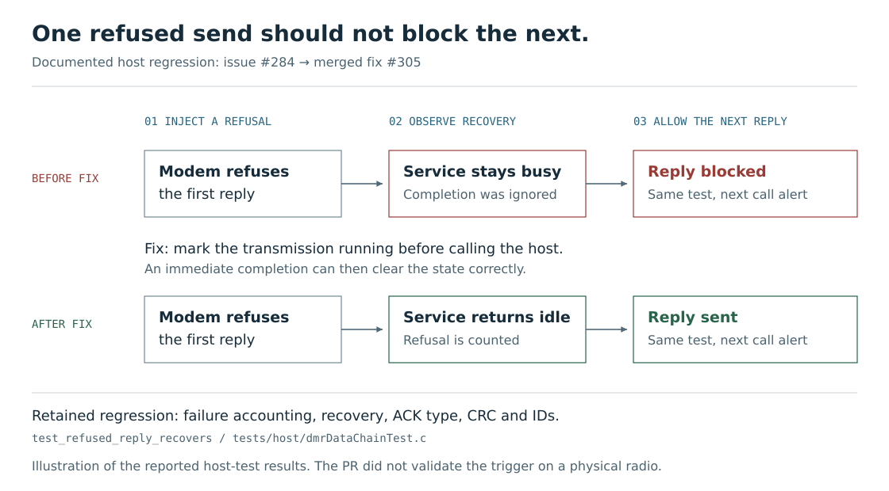

<!-- SPDX-License-Identifier: MIT -->
<!-- Copyright (c) 2026 The RadioFoundry Authors -->

# Virtual radio: reproducible bugs, reviewable fixes

**Development preview on this fork. Not merged upstream.**

Support for common DMR features and more radios gives more people a reason to try RadioFoundry. A good first
experience, useful responses when something goes wrong, and dependable updates give them reasons to keep using it
and recommend it to others. Better tools can help more contributors investigate problems and keep that work
manageable as the project grows.

The goal here is to bring a repeatable failing test to a bug report or pull request, then show the fix passing.
A maintainer can investigate the same modeled failure without first assembling the contributor's radio setup.

RadioFoundry already has host tests, software-in-the-loop tests, a UI simulator and hardware-in-the-loop tests.
**This preview runs several radios through their actual firmware tasks, controls the conditions, and repeats the
same interaction.** Each radio runs on Linux with modeled hardware and a controlled clock. The firmware's own
startup, FreeRTOS tasks, debug link and suitable HIL test scripts are reused.

## A result already upstream

During the broader SIL work, an injected modem refusal exposed a bug: after one failed transmission, the data
service remained busy and blocked later replies. The investigation was reduced to a small reproduction in the
project's existing host tests. [Issue #284](https://github.com/RadioFoundry/RadioFoundry/issues/284) records that
reproduction; [merged PR #305](https://github.com/RadioFoundry/RadioFoundry/pull/305) contains the fix and regression.



[Open the before-and-after diagram](images/virtual-radio-data-recovery.svg).
The retained test checks recovery, failure accounting, and the next acknowledgement's type, CRC and source and
destination IDs. The fix and test landed independently of the virtual-radio infrastructure. This earlier SIL
finding illustrates the contribution model: use the tools to investigate, then bring upstream a focused correction
and a regression it can maintain in its existing test framework.

## Try the multi-radio workflow

The preview's two-radio check exercises call setup and an acknowledged text message. It records the inputs and
replays them in fresh processes at different speeds, comparing traces and screen, UI-state and storage checkpoints.
It also checks that raw codeplug writes stop recording before their contents are saved.

After [building the preview](virtual-radio-quickstart.md#build-and-start), run:

```sh
python3 tools/conductor/checks/interaction_check.py
```

Success ends with `interaction_check: PASS --part all`. The [quickstart](virtual-radio-quickstart.md) also covers
browser controls and running existing boot/UI tests through the virtual debug link.

## Scope and validation

These checks establish behavior in the modeled software paths. RF, interrupt timing, audio quality and unmodeled
peripherals still need physical-radio tests. The virtual vocoder does not validate decoded speech. The case study
above reports host-test results; the upstream PR did not validate the triggering condition on physical radios.

For the refreshed preview, startup, the two-radio interaction and replay, boot/UI tests, and focused conductor tests
passed. Full CI and physical-radio validation were not run for that refresh. See [checks and CI](virtual-radio-checks.md)
for the commands and [engine capabilities](virtual-radio-architecture.md#engine-capabilities) for differences between
the host virtual radio and the optional firmware emulators.

## What maintaining it would involve

Reusing the firmware tasks and protocol engines avoids a second implementation of their behavior. The added test
environment still needs upkeep:

- Keep the host FreeRTOS port aligned with kernel and firmware startup changes.
- Check the hardware models against real behavior so their results remain useful.
- Maintain scenarios and recording formats, and keep CI runtime practical.

The time saved investigating and reviewing fixes needs to justify that work. That broader benefit still needs to
be demonstrated in regular use.

## Where this work can help next

The next step is to repeat the pattern above: investigate a useful problem, isolate its cause, and contribute a
focused fix and regression test using existing upstream tests wherever practical. That gives maintainers concrete
results to judge before considering which additional infrastructure belongs upstream.

| To explore further | Start here |
|---|---|
| Build it, run the example, or use the browser controls | [Quickstart](virtual-radio-quickstart.md) |
| Inspect what the checks establish | [Checks and CI](virtual-radio-checks.md) |
| Understand the design, models and clean-room boundaries | [Architecture and SVG diagram](virtual-radio-architecture.md) |
| Review how firmware tasks run on the host | [Host execution](virtual-radio-host.md) |
| Review the process-to-process protocol | [Control channel](virtual-radio-channel.md) |
