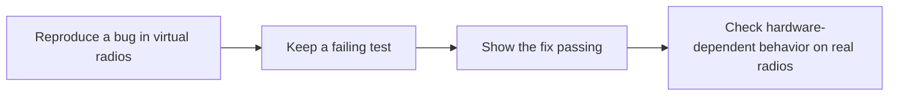

<!-- SPDX-License-Identifier: MIT -->
<!-- Copyright (c) 2026 The RadioFoundry Authors -->

# Virtual radio: reproducible bugs, reviewable fixes

**Development preview on this fork. Not merged upstream.**

The goal is to let a contributor bring a repeatable failing test to a bug report or pull request, then show the fix
passing. A maintainer could run the same case without first assembling the contributor's radio setup.

This preview runs RadioFoundry's own firmware tasks on Linux, with modeled hardware and communication between
virtual radios. It records the inputs and results so a software failure can be investigated again in fresh processes.
The intended benefit is less back-and-forth reproducing problems and stronger regression coverage as radio and
feature support grows. Whether that saves enough effort to justify maintaining the tools still needs to be shown.



## One working example

The included two-radio check exercises call setup and delivery of an acknowledged text message. It records the run,
then repeats the inputs in new processes at different playback speeds. The traces and screen, UI-state and storage
checkpoints must match. It also checks that a raw codeplug write stops the recording before its contents are saved.

After [building the preview](virtual-radio-quickstart.md#build-and-start), run:

```sh
python3 tools/conductor/checks/interaction_check.py
```

Success ends with `interaction_check: PASS --part all`. This check passed on the refreshed preview, along with
startup, boot/UI tests over the virtual debug link, and focused conductor tests. These are software results; the
virtual vocoder does not validate decoded speech. Full CI and physical-radio validation were not run for the refresh.

For a maintainer, the useful result is an executable account of what happened and what should happen. Once a bug
can be reproduced in this environment, its scenario can help verify a correction and catch the same failure later.

## How it fits the existing tests

RadioFoundry already has host tests, software-in-the-loop tests, a UI simulator and hardware-in-the-loop tests.
This experiment runs the firmware's own startup and FreeRTOS tasks, then coordinates several radio processes on one
controlled timeline. That lets a scenario exercise interactions between task scheduling, radio behavior, UI input
and storage. It also reuses the existing debug link and suitable HIL test scripts.

Hardware testing remains necessary for RF, interrupt timing, audio quality and peripheral behavior that the models
do not reproduce. A passing virtual test is evidence about the modeled path, not proof that every supported radio
works. The [architecture diagram](virtual-radio-architecture.md#layers) shows where that boundary sits.

## What maintaining it would involve

The preview adds a host FreeRTOS port, virtual hardware models and Python tools for coordinating and replaying runs.
Those carry ongoing costs:

- The host port must stay aligned with FreeRTOS and firmware startup changes.
- Models need checks against real behavior; an inaccurate model can give a convincing but misleading result.
- Scenarios, recording formats and CI runtime need upkeep as firmware behavior changes.

The firmware tasks and protocol engines are reused, which avoids maintaining a second implementation of them.
It does not eliminate the cost of maintaining the test environment. The optional firmware emulators add further
models and dependencies; their [capabilities and limits](virtual-radio-architecture.md#engine-capabilities) differ
from the host virtual radio.

## A useful first contribution

The proposal is to use this fork to demonstrate one useful bug reproduction and a regression test for its fix.
That would give maintainers a concrete example to judge before deciding which infrastructure, if any, belongs
upstream. This preview is available to try; it does not require adopting the whole system to benefit from a finding.

| To explore further | Start here |
|---|---|
| Build it, run the example, or use the browser controls | [Quickstart](virtual-radio-quickstart.md) |
| Inspect what the checks establish | [Checks and CI](virtual-radio-checks.md) |
| Understand the design, models and clean-room boundaries | [Architecture and SVG diagram](virtual-radio-architecture.md) |
| Review how firmware tasks run on the host | [Host execution](virtual-radio-host.md) |
| Review the process-to-process protocol | [Control channel](virtual-radio-channel.md) |
